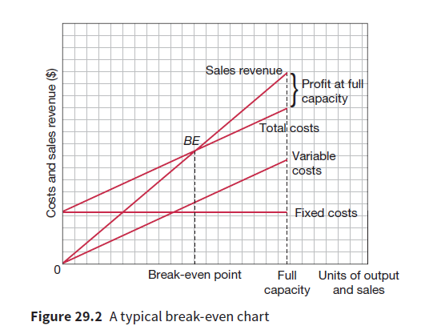

## Break even analysis

* Break even point is where neither profit nor loss is made. Total revenue = total costs
* Below the break even point, a business makes losses and above the break even point the business makes profits.

### How to construct a Break even chart:
* The fixed cost line is horizontal, indicating that fixed costs remain the same regardless of output level.
* Sales revenue starts at zero because there is no revenue without sales.
* The variable cost line starts at zero (0), showing that variable costs only occur with production. It’s often not included in charts for simplicity.
* The total cost line starts at the fixed cost level and rises with variable costs added to it.

  \
   

### Margin of safety

* The amount by which current sales level exceeds the break-even point
* Indicates how much sales could fall without the firm going into losses

### Break even equation

* Break-even level of output = fixed cost/contribution per unit
* Contribution per unit = selling price – variable cost per unit

### Break even analysis – benefits

* Easy to construct and interpret
* Managers can redraw the graph to see effect of changes in costs and prices on profits and break-even points
* Helps in decision making
* Break-even analysis has equations which produces a precise break-even results.
* Gives information relating the margin of safety
* Helps in deciding which location to select.

### Break even Analysis - limitations

* Costs and revenues are shown as straight lines, but in reality, costs like labour may increase with higher output.
* High output might need price cuts, which could create multiple break-even points.
* Semi-variable costs can complicate break-even analysis.
* Break-even charts assume all units produced are sold, which isn’t always true.
* Fixed costs may change at different output levels, especially near maximum capacity.
* New businesses base break-even analysis on forecasts, which can be inaccurate.

### Break even analysis – evaluation

* Assumption that costs and revenue is represented by straight lines is unrealistic
* Not all costs can be classified between fixed & variable
* No allowance for inventory levels
* Unlikely that fixed costs remain unchanged throughout

