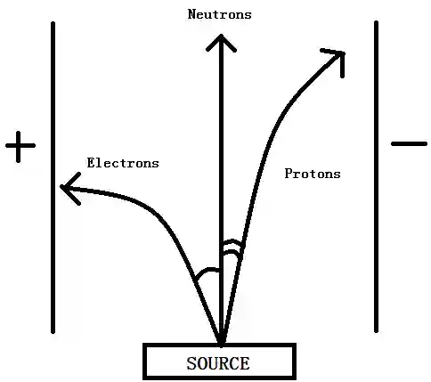

# Atomic Structure

## Particles in the atom and atomic radius

* Atoms are mostly empty space surrounding a very small, dense nucleus that contains

  protons and neutrons

* Electrons are found in shells in the empty space around the nucleus

### Relative Charges And Masses of Subatomic Particles

#|
||

subatomic particle

|

relative charge

|

relative mass

||
||

Proton

|

\+1

|

1

||
||

Neutron

|

0

|

1

||
||

Electron

|

\-1

|

1/1836

||
|#

### Atomic/Proton Number (Z) :

* The total number of protons in the nucleus of an atom

* In a neutral atom, the atomic number also equals the total number of electrons

### Mass/Nucleon Number (A) :

* The total number of protons and neutrons (together known as nucleons) in the nucleus of an atom

* The number of neutrons in an atom is calculated by subtracting the atomic number from the mass number (A - Z).

Deduce the number of protons, neutrons, and electrons in the ion ${}^{31}_{15}\text{P}^{3-}$  *\[2 marks\]*

* Number of protons : 15

* Number of Neutrons : A - Z = 31 - 15 = 16

* Number of Electrons : Charge of the ion is 3-, indicating a gain of 3 electrons, thus 15 \+ 3 = 18

### Distribution of Mass :

* Concentrated in the nucleus

* Negligible mass in the orbitals

### Distribution of Charge :

* Concentrated positive charge in the centre of the atom (Nucleus)

* Diffused negative charge surrounding the nucleus in the orbitals

* Overall neutral as Proton number = Electron number

### Behaviour of Subatomic Particles in an Electric Field

Electron:

* Deflected to the positive plate

* Extremely large deflection

Proton:

* Deflected to the negative plate

* Smaller deflection compared to electrons due to their relatively larger mass

Neutron:

* Continues in a straight undeflected line due to the lack of charge

### Trends in atomic radius

\- Across a period:

* Nuclear charge increases

* Constant shielding effect ( repulsion from inner shell electrons)

* Stronger nuclear attraction

* Thus atomic radius **decreases**

\- Down the group:

* More quantum shells

* Increased shielding

* Weaker nuclear attraction despite an increase in nuclear charge

* Thus atomic radius **increases**

### Trends in ionic radius:

General trend compared to parent atoms:

* Cations are smaller than parent atoms

* Anions are larger than parent atoms

Across a period:

* Increasing number of protons

* Increasing nuclear charge

* Greater electrostatic force of attraction between the positively charged nucleus and outershell electrons

* Thus ionic radius **decreases**

Down the group

* More quantum shells

* Weaker nuclear attraction

* Ionic radius **increases**