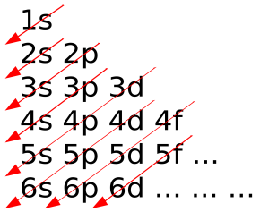
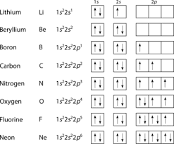

## Electrons, energy levels and atomic orbitals

Principal Quantum Number :

* An integer number that designates the main energy level (shell) of an electron

* As the principal quantum number increases

  * The shell is located further from the nucleus

  * Has higher energy

  * Can hold more electrons

Shells : Main energy level

Sub shells : Divisions within the shells which are labelled s,p,d and f

Orbitals : Specific region within a sub shell where there is a high probability of finding an electron (Each orbital can hold a maximum of two electrons with opposite spins)

Ground State : The lowest energy and most stable arrangement of electrons in an atom

#|
||

**Sub-shell**

|

**Number of Orbitals**

|

**Electrons per Orbital**

|

**Total Maximum Electrons**

||
||

s

|

1

|

2

|

2

||
||

p

|

3

|

2

|

6

||
||

d

|

5

|

2

|

10

||
|#

### Order of increasing energy of the sub-shells

$$1\text{s} < 2\text{s} < 2\text{p} < 3\text{s} < 3\text{p} < 4\text{s} < 3\text{d} < 4\text{p}$$

### Electronic Configuration:

* Electrons are filled singly in the subshells

* Then arranged in pairs as completely filled or partially filled subshell is more stable as less repulsion

* 4s orbital is first filled completely and then moved to 3d

**Note :** Chromium and copper are exceptions to the rule of filling 4s completely

Chromium electronic configuration :  \\(1s\^\{2\}2s\^\{2\}2p\^\{6\}3s\^\{2\}3p\^\{6\}3d\^\{5\}4s\^\{1\}\\)

Copper electronic configuration : \\(1s\^2 2s\^2 2p\^6 3s\^2 3p\^6 3d\^\{10\} 4s\^1\\)

* Electrons fill available atomic orbitals in order of **increasing energy** to ensure the atom resides in its most stable, lowest-energy state (ground state)

* Lower-energy sub-shells (closer to the nucleus with less shielding) fill completely before higher-energy sub-shells

* Electrons carry a negative charge therefore forcing two electrons to share the same orbital creates mutual electrostatic repulsion.

* This added repulsion increases the potential energy of the electrons, making paired arrangements less stable than singly occupied ones.

### Short-hand electronic configuration:

Example : Fe , Z = 26

* Total number of electrons : 26

* Full electronic configuration : $$1\text{s}^2,2\text{s}^2,2\text{p}^6,3\text{s}^2,3\text{p}^6,4\text{s}^2,3\text{d}^6$$

* Identify the nearest preceding noble gas : Argon (Ar)

* Substitute and write the shorthand notation : $\left\[\text{Ar}\right\],4\text{s}^2,3\text{d}^6$

  ### S and P orbitals

* S orbitals are spherical in shape

* P orbitals are dumbell shaped

**Free radical:** A species with one or more unpaired electrons