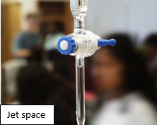
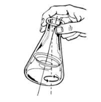

# Titrations

* Burette has to be written to 2 DP.
* Two best titres must be within $0.1\ cm^{3}$ of each other
* If first two titres are within $0.1\ cm^{3}$ then no need for the
  3rd titre
* Repeat and find the average titre volume with total spread of not
  more than $\ 0.20\ cm^{3}$*.*

**Use of a Burette**

| **Advantages** | **Disadvantage** |
|----|----|
| Lower $%$ error | Takes longer to add the reagent |
| More accurately calibrated |    |

* Clean all apparatus properly with distilled water prior to starting the experiments.
* Whilst pipetting, the tip of the pipette should be placed against
  the wall of the container. In this way, droplets of the solvent will
  not spill out of the container.
  * Clean the walls with distilled water to ensure you include all
    moles of solution.
  * Add indicator as per the instructions. Add too much, and you
    would get incorrect results.
* Clean burette and pipette with solution, but not volumetric and
  conical flask as it will give inaccurate values.
* Always read the bottom meniscus of the burette and ensure the
  burette does not have any air bubbles to remove the jet space.
  * Tap it to free air bubbles.
  * Open the tap to fill the jet space.

* Always swirl the conical flask.
  * Use a white tile underneath to observe any colour change.
  * Titration ends when any colour change is permanent.

     
* In your second titration attempt (after the rough titre), adjust the
  burette tap so that it dispenses drop-wise when the reading is near
  the end-point to find the exact titre value.
* **Titration table should look like this:**

<table>
<thead>
<tr class="header">
<th>Initial Burette Reading/ cm3</th>
<th>
0.00

(It must never start from 50 cm3)
</th>
<th>0.00</th>
<th>0.00</th>
</tr>
</thead>
<tbody>
<tr class="odd">
<td>Final Burette Reading/ cm3</td>
<td></td>
<td></td>
<td></td>
</tr>
<tr class="even">
<td>Titre/ cm3</td>
<td></td>
<td></td>
<td></td>
</tr>
<tr class="odd">
<td>Best Results</td>
<td>(add tick here)</td>
<td></td>
<td></td>
</tr>
</tbody>
</table>