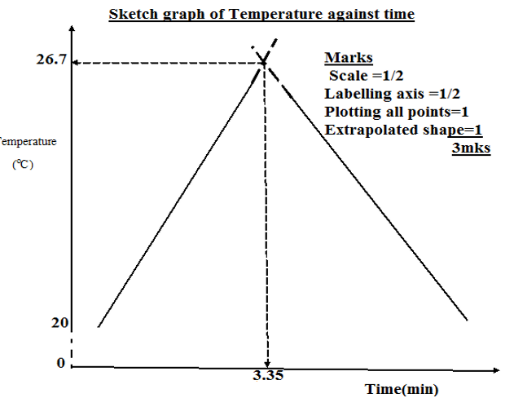
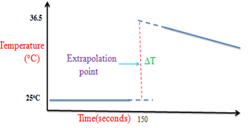

# Enthalpy Change

* Temperature is measured in 1 decimal places and units given in
  degree Celsius.
* When measuring masses, a table with values in $2\ D.P.$ must be setup. **For example:**

|**Mass of the container + mass of the lid /$g$**||
|:---|:---|
|Mass of the container + mass of the lid + the sample /$g$||
|Mass of the container + mass of the lid + residue/$g$||
|Mass of sample used /$g$||

* All the data must have the same number of decimal places.
* **Use the equation** ${Q = \ mc\Delta T}$ **for heat
  released:**
  * $M$ is mass of the total mixture of the **solution**
    * Assuming mass is equivalent to volume of **solution** where $1g$ is
      $1\ cm^{3}$
  * $C$ is specific heat capacity (assuming it’s the same as water
    i.e. $4.12$)
  * $\text{ΔT}$ is temperature change
  * No incomplete combustion of fuel occurs
  * Density of the solution is the same as water
  * Units in $\text{J }\text{mol}^{- 1}$

<!-- end list -->

* **To calculate enthalpy change:**
  * Use the equation $\Delta H = \ Q/mol$
    * **Units:** $\text{KJ}\text{mol}^{- 1}$, so divide heat
      released ($Q$) by 1000.
* **Enthalpy graphs**
  * **To find max temp change via extrapolation:**

* **Exothermic graphs:**

