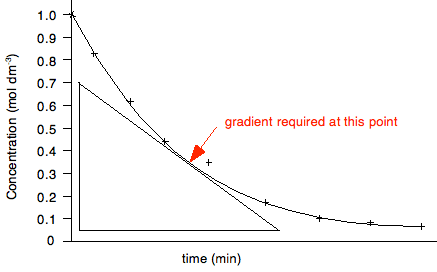

# Rates of reaction

* **To calculate rate:**
  * Appearance of product/change in concentration of product
  * Disappearance of reactants/change in mass
  * **Unit:** 1/time ($s^{- 1})$
  * Finding gradient of a concentration-time graph
    * The higher the gradient (the steeper the graph), the higher
      the rate of reaction.
    * The gradient of the graph decreases with time; thus, rate is
      inversely proportional to time.

* **A general rates table for investigation effect of concentration on
  rates:**

| Experiment number | Vol of reagent/ ${cm}^{3}$ | Vol of distilled water/ $cm^{3}$ | Reaction time/$s$ | Rate of reaction/ $s^{- 1}$ |
|----|----|----|----|----|
|    |    |    |    |    |
|    |    |    |    |    |
|    |    |    |    |    |

* Replace the IV columns with other factors that affect rate depending
  on the question.
* Take a minimum of 3 experimental readings.
* Ensure all other variables are kept constant so that any change in
  rate is caused by the IV.

<!-- end list -->

* **To improve rate of reaction:**
  * Increase the concentration of a reactant.
  * Increase the temperature of the reactants.
  * Increase the surface area of a reactant.
  * Add a catalyst to the reaction.

