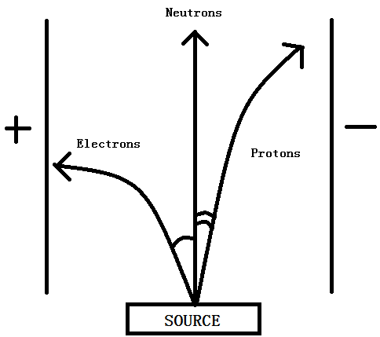

## Behaviour of a Beam of Subatomic Particles

  - **Protons:** positively charged $\therefore$ deflected to -ve pole

  - **Neutrons:** no charge $\therefore$ not deflected

  - **Electrons:** negatively charged $\therefore$ deflected to +ve
    pole

  - e- lighter than P+ $\therefore$ deflected at
    greater angle
