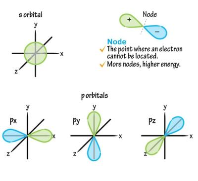

## Orbitals

* s orbitals are spherical, with the nucleus at the centre
* p orbitals are dumbell-shaped

 

* A free radical is a species with one or more unpaired electrons.

Note: ions and free radicals are different.