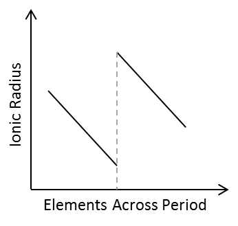

## Ionic Radius

* **Ionic Radius:** describes the size of an ion

* **Positive Ion:** smaller radius than original neutral atom because shell no. decreases, the screening effect decreases, but the attraction of the nucleus increases.
* **Negative Ion:** larger ionic radius than neutral atom because e-s added while nuclear charge remains same

<table>
<thead>
<tr class="header">
<th><strong>Groups</strong></th>
<th><strong>1 to 3</strong></th>
<th><strong>5 to 7</strong></th>
</tr>
</thead>
<tbody>
<tr class="odd">
<td><strong>Ion</strong></td>
<td><strong>Positive</strong></td>
<td><strong>Negative</strong></td>
</tr>
<tr class="even">
<td><strong>No. of shells</strong></td>
<td> <strong>n</strong> <strong>−</strong> <strong>1</strong> </td>
<td> <strong>n</strong> </td>
</tr>
<tr class="odd">
<td colspan=3>
<strong>Across the period:</strong>

<ul>
<li>
Proton no. and effective nuclear charge increases
</li>
<li>
Ionic radius decreases
</li>
</ul></td>
</tr>
</tbody>
</table>

* Negative ions are always larger than positive ions in the same period as they have one more shell
* Ionic radius increases down the group since the number of electron shells increases.
* As the negative charge on anion increases, the ionic radius increases since the number of electrons gained increases such that the number of electrons exceeds the number of protons.
* As the positive charge on the cation increases, the number of electrons lost increases, so the electrostatic attraction between the nucleus and outer electrons increases.

