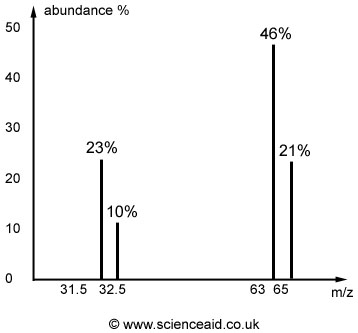

## Mass Spectra

- Abundance of isotopes can be represented on a mass spectra diagram

$$Relative\ Abundance = \frac{\text{Peak Height}}{\text{Total Height}} \times 100$$

$$A_r = \sum\frac{Mass\  \times \ Relative\ Abundance}{100}$$

