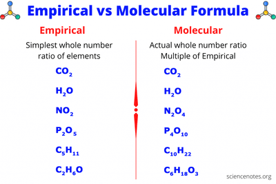

## Empirical and Molecular Formulae

* **Empirical Formula:** gives the simplest ratio of different atoms present in a molecule
* **Molecular Formula:** gives actual numbers of each type of atom in a molecule
* Molecular formula can be calculated using the **Mr** of a compound
  and its empirical formula

$$
Molecular\ Formula = \left( \text{Empirical Formula} \right)_{n}
$$

$$
\text{Where }n = \frac{\text{Molecular Mass}}{\text{Mass of Empirical Formula}}
$$

$$
\%\ Composition = \frac{Atomic\ Mass\  \times \ No.\ of\ Moles}{\text{Molar Mass of Compound}} \times 100\%
$$

 