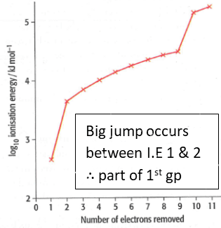

## Ionisation Energies (I.E)

* **1\<sup\>st\</sup\> I.E:** The energy required to remove one mole of electrons from one mole of gaseous atoms to form one mole of gaseous unipositive ions.
* **Each Successive I.E is higher than the previous one** because as e\<sup\>-\</sup\>s are removed, protons \> e\<sup\>-\</sup\>s $\therefore$ the attraction between protons and remaining electrons increases
* Successive [I.Es](http://I.Es) have a large jump in their value when e\<sup\>-\</sup\>s removed from the lower energy shell
* Deduce group no. by checking when 1\<sup\>st\</sup\> big jump occurs

