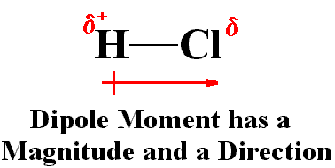

# Chemical Bonding

## Electronegativity and Bonding

* **Electronegativity**: the power of an atom to attract electrons to itself
* **The electronegativity depends on:**
  * The radius of atom (atomic size) **inversely**$\mathbf{\  \propto}$
    electronegativity
  * Nuclear attraction **directly**$\mathbf{\  \propto}$
    electronegativity
* Electronegativity **increases across a period** because of atomic radius ↓ and nuclear attraction ↑, so polarity ↑
* Electronegativity **decreases down a group** because of atomic radius ↑ and nuclear attraction ↓, so polarity ↓
* **Dipole Moment:** slight charges on atoms in a covalent bond due to differences in electronegativity
* The difference between the electronegativity of two atoms in a compound determines the overall dipole moment and overall polarity of the compound.
* A large difference in electronegativity will make the bond more polar (more ionic in nature), but a small difference in electronegativity will make the bond less polar (more covalent in nature)

