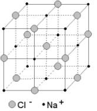
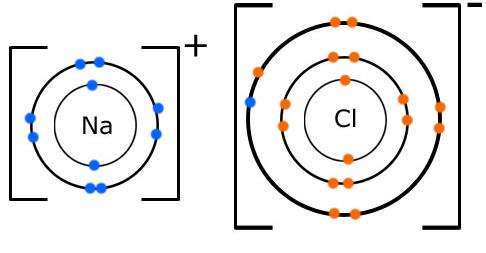

## Ionic (Electrovalent) Bonding

* An ionic bond is the electrostatic attraction between oppositely charged ions.
* Structure: giant ionic lattice, crystalline solids

* Have high melting and boiling points

* **Coordination Number:** number of oppositely charged ions that surround a particular ion in an ionic solid
* E.g: NaCl, MgCl2

