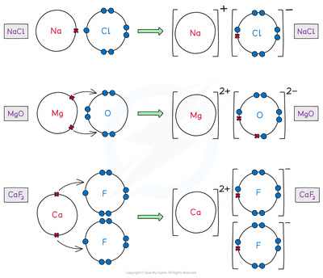
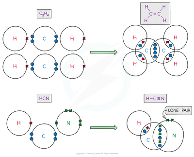

## Dot and Cross Diagrams

1. For anions, electrons are added to the atom (e.g. Chlorine forms Chloride Cl- ions.)

2. For cations, electrons are removed from the atom (e.g. Sodium forms Na+ ions.)

3. Atoms form the same number of bonds as the number of electrons required to be added/removed for maximum stability. (e.g.: Chlorine will form 1 bond, Sodium will form 1 bond, but Calcium Ca2+ will form 2 bonds)

4. The central atom may expand its octet to form more bonds if necessary (e.g, S8)

5. In ionic compounds, electrons are shown to be completely transferred to each of the ions in the compound.

   

6. In covalent compounds, electrons are shown to be shared between the atoms in the molecule.

   

7. Use a legend of different shapes (e.g. solid circle, unfilled circle, triangle, cross etc.) to show which electrons come from which atom in the same way as colours have been used in the above diagrams.