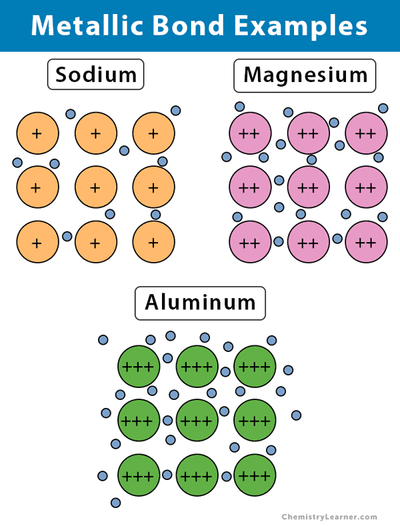

## Metallic Bonding

* Strong electrostatic forces of attraction between metal cations and
  delocalized mobile electrons
* **Structure:** lattice of +ve ions surrounded by ­­mobile
  e-s
* **Strength of metallic bond increases with:**
  * Increasing **positive charge** on the ions in the lattice
  * Decreasing **size of metal ions** in the lattice
  * Increasing **number of mobile e-s** per atom

   

