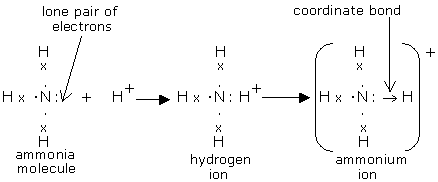
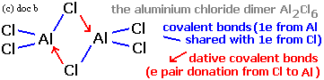

## Coordinate (Dative Covalent) Bonding

* A coordinate bond is a covalent bond where both electrons in the bond come from the same atom
* **Conditions:**
  * An atom should have a lone pair of electrons
  * An atom should be in need of a pair of electrons
* **Donor:** the atom that supplies the pair of electrons
* **Acceptor:** the atom that accepts the pair of electrons
* Coordinate bond is represented by an “$\rightarrow$” drawn from the atom donating
  towards the atom accepting
* **Formation of Ammonium ion**
  $\mathbf{NH_\mathbf4^\mathbf+}$:

* **Formation of**
  $\mathbf{\text{AlCl}_3}$
  **dimer
  (**$\mathbf{\text{Al}_2Cl_6}$):

* Above 750oC, exists as vapor & covalent molecule
  AlCl3
* As vapor cools, exists as dimer Al2Cl6
* Bond angle as AlCl3 = 120o
* Bond angle as Al2Cl6 = 109.5o