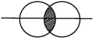
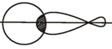
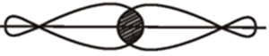
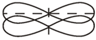

## Orbital Overlap

* For a covalent bond to form, atomic orbitals containing unpaired
  valence electrons must overlap each other
* **S – S (Sigma Σ)**

>  

* **S – P (Sigma Σ)**

>  

* **P – P (Sigma Σ)**

 

* **P – P (Pi** $\mathbf{\pi}$***)***

>  

* Sigma bond has greater overlap $\therefore$ $\sigma > \pi$
* Pi bond cannot exist without a Sigma bond.

**Note**: Elements in Period 3 can expand their octet by making use of the energetically accessible but lower lying d-subshell for bonding. This means that some elements of period 3 can bond with more than 4 electrons at once. (e.g: Sulfur, Phosphorus etc)

