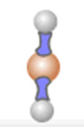
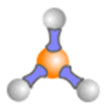
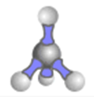
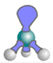
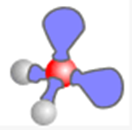
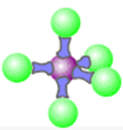
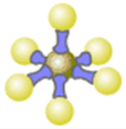

## Shapes of Molecules

* The shape and bond angles of molecules depend on:
  * The number of pairs of electrons around the central atom
  * Whether these pairs are lone pairs or bonded pairs
* Valence shell electrons are arranged in pairs to minimize repulsion
  between themselves
* **Order of Repulsion Strength (VSEPR Theory):**

* **2 pairs of e’s**
  * 2 bonded, 0 lone pair
    * Linear
    * 180O
    * E.g. CO2

* **3 pairs of e’s**
  * 3 bonded, 0 lone pair
    * Trigonal planar
    * 120O
    * E.g. BF3

* **4 pairs of e’s**
  * 4 bonded, 0 lone pair
    * Tetrahedral
    * 109.5O
    * E.g. CH4

* 3 bonded, 1 lone pair
  * Pyramidal
  * 107O
  * E.g. NH3

* 2 bonded, 2 lone pair
  * Angular
  * 104.5O
  * E.g. H2O

* **5 pairs of e’s**
  * 5 bonded, 0 lone pair
    * Trigonal Bipyramid
    * 90O and 120O
    * E.g. PF5

* **6 pairs of e’s**
  * 6 bonded, 0 lone pair
    * Octahedral
    * 90O
    * E.g. SF6

