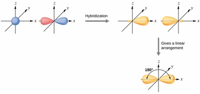
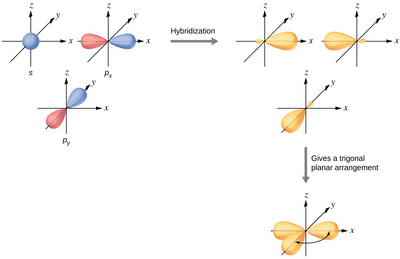
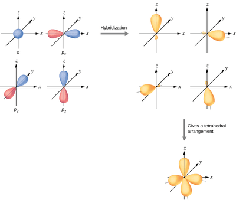

## Hybridisation

**Definition**

* Mix atomic orbitals like s and p to form new hybrid orbitals like $sp^2$, $sp^3$, and $sp$.
* The resultant orbital has different energy levels, shapes, and properties.

$sp$ Hybridisation

* When 1 s orbital combines with 1 p orbital.
* They form linear molecules with $180^o$ angles, e.g. $CO_2$ and all hydrocarbons containing 2 bonds like $C_2H_2$ (Carbon-Carbon triple bond).
* Has an equal amount of s and p orbital properties.

**$sp^2$ Hybridisation**

* When 1 s orbital combines with 2 p orbital.
* They form trigonal planar molecules with $120^o$ angles, e.g. $BH_3$ and all hydrocarbons containing 3 bonds like $C_2H_4$ ( $C=C$ ).
* Has twice the property of p orbital properties than s orbital.

**$sp^3$ Hybridisation**

* When 1 s orbital combines with 3 p orbital.
* They form tetrahedral molecules with $109.25^o$ angles, e.g. $SiCl_4$, and all hydrocarbons containing 4 bonds like $C_2H_6$ ( $C-C$ ).
* Has three times the property of p orbital properties than s orbital.

