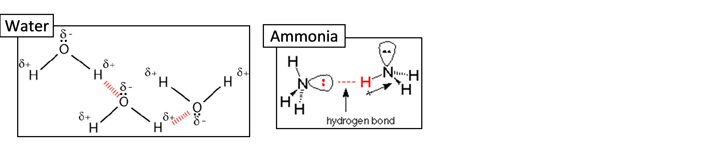

## Hydrogen Bonding

* The strongest type of intermolecular force in covalent bonds
* For hydrogen bonding to occur, we need:
  * A molecule having a H atom bonded to F, O or N
  * Molecule having F, O or N atom with lone pair of e-s

 **Note**: Important properties of water (high melting/boiling points, high surface tension) are due to the strong hydrogen bonds present between water molecules.