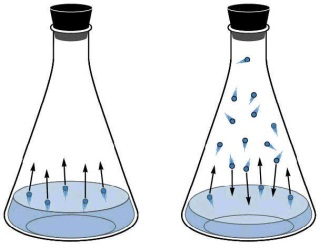

## Liquid State

* Particles touching but may have gaps
* Have $E_{K}$ slide past each other in random motion
* **Enthalpy of Fusion:** heat energy required to change 1 mole of solid into a liquid at its melting point
* **Heating a Solid (melting):**
  * Energy transferred makes solid particles vibrate faster
  * Forces of attraction weaken & solid changes to liquid
* **Enthalpy of Vaporisation:** heat energy required to change 1 mole of liquid into a gas at its boiling point
* **Heating a Liquid (vaporisation):**
  * Energy transferred makes liquid particles move faster
  * Forces of attraction weaken
  * The highest energy particles escape first
  * Liquid starts to evaporate – temp. Below b.p.
  * Forces weaken further – particles move faster & Spread
  * Liquid boils – temp. At b.p.
* **The evaporation of a liquid in a closed container**

* Constant evaporation from the surface
* Particles continue to break away from the surface but are trapped in space above the liquid.
* As gaseous particles collide, some of them hit the surface of the liquid again and become trapped there.
* An equilibrium is set up in which the number of particles leaving the surface is balanced by the number rejoining it.
* Liquid water molecules ⇌ Vapor water molecules
* A fixed number of gaseous particles will be in the space above the liquid in this equilibrium.

<!-- end list -->

* **Vapour Pressure:** pressure exerted by a vapour in equilibrium with a liquid.
* Vapour pressure **increases** as: 

