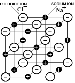
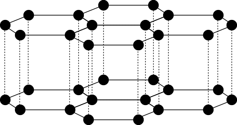
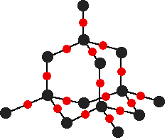
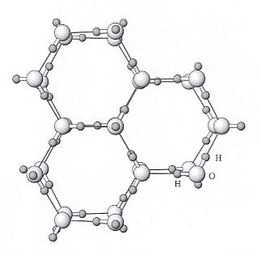
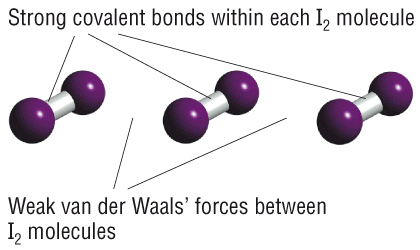
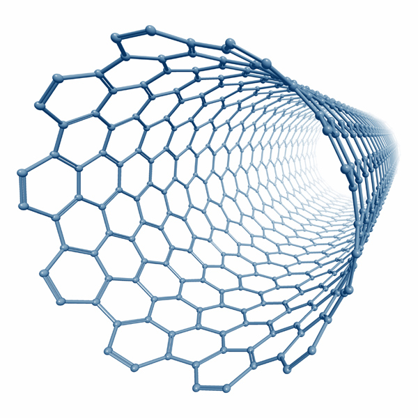

## Solid State

* **Ionic lattice**

* **Metallic lattice**

* **Simple molecular**

**Macromolecular Lattice:**

* **Diamond:**
  * High m.p./b.p. - each carbon forms four covalent bonds
  * Hard-tetrahedral structure
  * Doesn’t conduct electricity – no free $e^-$
  * Conducts heat extremely well - about 5 times higher thermal conductivity than silver
  * Used for cutting as is the strongest known substance and has sharp edges

* **Graphite:**
  * Three strong $sp^2$ covalent bonds
  * Fourth $e^-$ in p orbital $\therefore$ forms a pi bond, forming a cloud of delocalised electrons above and below the planes
  * Layers kept together by weak Van der Waal’s forces
  * High m.p./b.p. - strong covalent bonds throughout
  * Soft – forces between layers are weak
  * Conducts electricity - has delocalized electrons

* **Silicon(IV) Oxide:**
  * Each Si is bonded to 4 oxygen atoms, but each oxygen is bonded
    to 2 Si atoms
  * Sand is largely $SiO_2$
  * Similar properties to diamond

**Hydrogen-Bonded Lattice:**

* In ice form, water molecules slow down and come closer together
* Due to polarity, molecules form hydrogen bonds between lone pairs of
  oxygen & $\delta^{+}$charge of hydrogens
* Each water molecule has 2 H-bonds
* They arrange themselves into an open crystalline, hexagonal
  structure
* Due to large spaces, ice is less dense than water

* **Effect of Hydrogen Bonding on Physical Properties:**
  * **Relatively high m.p./b.p.:** many strong H-bonds
  * **High viscosity:** hydrogen bonding reduces the ability of water molecules to slide over each other
  * **High surface tension:** hydrogen bonds in water exert a downward force on the surface of the liquid
  * **Ice is less dense than water:** larger spaces between molecules in a hexagonal structure

**Simple Molecular Lattice:**

* **Iodine:**
  * Dark grey crystalline solid; vaporizes into purple gas
  * m.p./b.p. are slightly higher than room temp
  * Slightly soluble in water; dissolves in organic solvents
  * Diatomic molecules formed due to covalent bonds between individual atoms
  * Molecules have weak Van der Waals forces of attraction between
    them

* **Fullerenes:**
  * **Buckminsterfullerenes($C_60$)**
    * C atoms in pentagonal and hexagonal rings
    * Spherical
    * $C_60$ molecules held together by Van der Waals forces
    * Can conduct heat and electricity
    * Very strong and tough
    * Insoluble in water
    * Low m.p./b.p.

* **Nanotubes**
  * C atoms in hexagonal rings only
  * Cylindrical
  * The structure is rod-like due to continuing rings
  * Conducts heat and electricity
  * Very strong and tough
  * Insoluble in water
  * High m.p./b.p.

