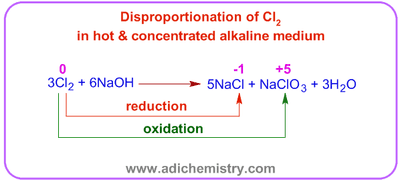
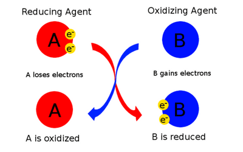

## Redox Processes

* Reaction where both oxidation and reduction occur

* This can be shown with changes in oxidation numbers of elements from the product side to the reactant side.

* E.g.
  $Ca_2Si + 6H_2O \rightarrow 2Ca(OH)_2 + SiH_4$

  * Calcium (Ca)
    * In **Ca₂Si**: Ca = **+2**

    * In **Ca(OH)₂**: Ca = **+2**

      As the oxidation stateis unchanged, calcium is not involved in the redox reaction
  * Silicon (Si)
    * In **Ca₂Si**: Si = **−4**

    * In **SiH₄**: Si = **+4**

      The oxidation state has increased; therefore, silicon is oxidised in the reaction
  * Hydrogen (H)
    * In **H₂O**: H = **+1**

    * In **SiH₄**: H = **−1**

      The oxidation state decreased; therefore, hydrogen was reduced in the reaction.

* **Disproportionation Reaction**: When the same species undergoes oxidation and reduction in a reaction.

  

* **Oxidising Agent**: A substance which helps to oxidise another species by accepting electrons from it and itself gets reduced in the process

* **Reducing Agent**: A substance which helps to reduce another species by donating electrons to it and itself gets oxidised in the process

