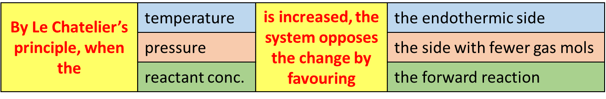

## Le Chatelier’s Principle 

  - When a chemical system in dynamic equilibrium is disturbed
    (conditions changed) it tends to respond in such a way so as to
    oppose the change and a new equilibrium is set up

