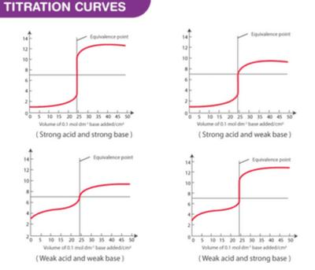

## Brønsted–Lowry Theory of Acids and Bases

* **Brønsted-Lowry Theory:**

  * An acid is a proton (H+) donor
  * A bases is a proton (H+) acceptor

* **Amphoteric:** substances that can act like bases or acids

* **Strong acid:** an acid that dissociates completely in solution (e.g., HCl)

* **Weak acid:** an acid that dissociates partially in solution (e.g., ethanoic acid)

* **Strong base**: a base that dissociates completely in solution (e.g., NaOH)

* **Weak base**: a base that dissociates partially in solution (e.g., ammonia)

* Strong acids/bases react more vigorously than weak acids/bases.

* Strong acids have lower pH values than weak acids.

* Strong bases have higher pH values than weak bases.

* When an acid reacts with a base, salt & water are formed. The pH changes in this neutralisation reaction can be graphed as shown in the image below: 