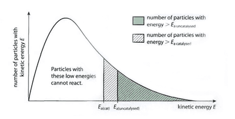

## Effect of Catalyst

* **Catalyst:** a substance that increases the rate of reaction but remains chemically unchanged at the end
* It does not alter the chemical composition of substances and only lowers the activation energy
* It provides a new route or mechanism to follow for reactants that
  requires less energy  
* Curve unchanged; only activation energy changes
* **Homogeneous catalysts:** reactant and catalyst are in the same
  physical state
* **Heterogeneous catalysts:** reactant and catalyst are in different
  physical states
* **Enzymes:** a protein molecule that is a biological catalyst. Most
  are specific to a substrate & function as lock-key

