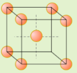
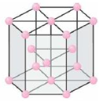
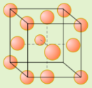

# The Periodic Table: Chemical Periodicity

## Introduction

<table border=1>
<thead>
<tr class="header">
<th><strong>Group</strong></th>
<th>1</th>
<th>2</th>
<th>3</th>
<th>4</th>
</tr>
</thead>
<tbody>
<tr class="odd">
<td><strong>Element</strong></td>
<td>Sodium</td>
<td>Magnesium</td>
<td>Aluminium</td>
<td>Silicon</td>
</tr>
<tr class="even">
<td><strong>Character</strong></td>
<td colspan=3 align=center>Metal</td>
<td align=center>Metalloid</td>
</tr>
<tr class="odd">
<td><strong>Structure</strong></td>
<td colspan=3 align=center>Giant metallic lattice</td>
<td align=center>Macromolecular</td>
</tr>
<tr class="even">
<td><strong>Bonding</strong></td>
<td colspan=3 align=center>Metallic bond between cations and delocalized e-</td>
<td>Covalent bonds between atoms</td>
</tr>
<tr class="odd">
<td><strong>Diagram</strong></td>
<td></td>
<td></td>
<td></td>
<td></td>
</tr>
</tbody>
</table>