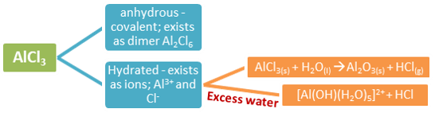

## Reactions of Chloride with Water

  - Sodium chloride simply dissolves in water. Water is polar
    $\therefore$ positive Na+ attracted to OH-
    while Cl- attracted to H+

  - MgCl2 slightly acidic because Mg ion has smaller radius &
    higher charge $\therefore$ attraction to water is so strong that
    H2O loses a proton and solution becomes slightly acidic

