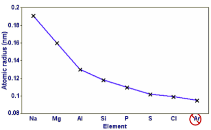

## Atomic Radius

  - P+ in nucleus increases so nuclear charge increases

  - There are more e-, but increase in shielding is
    negligible because each extra e- enters same principal
    energy level

  - $\therefore$ force of attraction between nucleus & e-
    increases ...

  - So atomic radius decreases.
