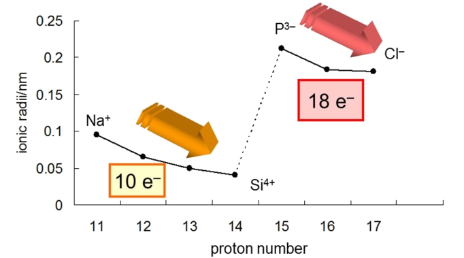

## Ionic Radius

  - Ionic radius decreases across a period however, since non-metals
    gain electrons, they have one more shell than metals therefore they
    always have a larger radius than metal ions