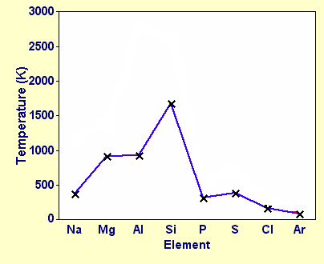

## Melting Point

* Na Al m.p. increases because delocalized e- per atom
  increases making metallic bond stronger
* Si has highest m.p. due to giant covalent structure
* The larger the molecule size, the stronger the Van Der Waals forces $\therefore$ S8 > P4 > Cl2 >
  Ar

