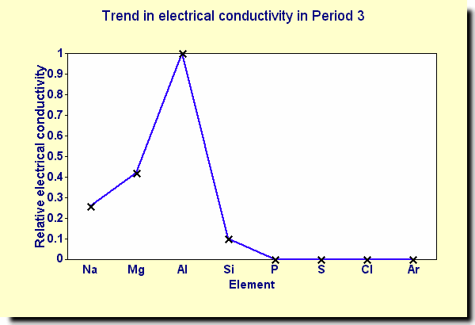

## Electrical Conductivity

  - Na < Mg < Al because no. of delocalized electrons which can carry
    charge increases

  - Silicon is a semi-conductor

  - Non-metals – covalent $\therefore$ no charge