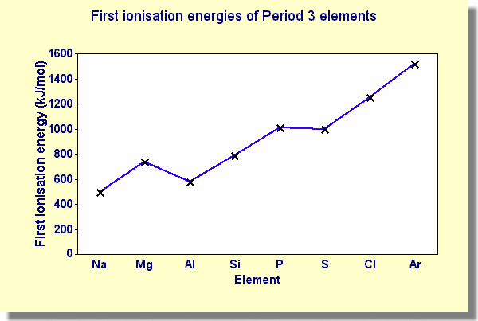

## First Ionisation Energy

* Generally, increases as no. of protons increases
* Decrease Mg $\rightarrow$ Al: more distant and less effective nuclear charge on 3p
  orbital
* Decrease P $\rightarrow$ S: in S, one electron paired $\therefore$ causing repulsion and easier to lose an electron

