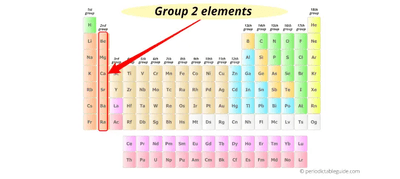

# Group 2

## Introduction

 

* **m.p./b.p. decreases down group:** atoms/ions get larger, the distance between nuclei & e-s increases $\therefore$ bonds weaker
* **m.p./b.p. higher in gp. 2 than 1:** 2e-s per atom donated into delocalized system $\therefore$ metallic bonding stronger
* **density increases down group:** mass of atoms increases faster than their size (volume) as atomic no. increases

