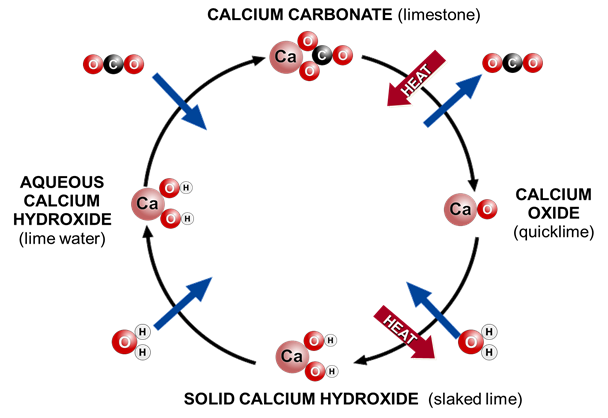

## Uses of Group 2 Metals

* **Calcium compounds:**

* **Calcium oxide (lime):** basic oxide used to neutralize acidic soil and used as a drying agent for drying ammonia
* **Calcium carbonate (limestone):** used as building material (cement, concrete) etc., for extraction of iron, glass industry, neutralize soil or chemical waste

