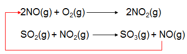

## Oxides of Nitrogen

N2(g) + O2(g)$\rightarrow$ 2NO(g) or
½N2(g) + O2(g)$\rightarrow$ NO2(g)

  - **Naturally:** during lightning, EA provided for
    N2 to react

  - **Man-made:** in car engine, high temp. and pressure

  - **Catalytic convertors:** exhaust gases passed through catalytic
    convertors containing a catalyst (platinum/ palladium/nickel)
    helping to reduce oxides to nitrogen.

  - **Catalytic role in oxidation of sulphur dioxide:**

