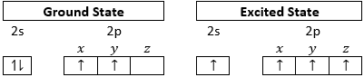
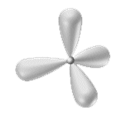
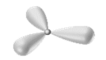

## Hybridisation

* **Hybridisation:** mixing up of different atomic orbitals resulting
  in new orbitals of equal energy.
* **Carbon’s Electron Configuration:**

 

<table>
<thead>
<tr class="header">
<th><strong>sp3</strong></th>
<th><strong>sp2</strong></th>
<th><strong>sp</strong></th>
</tr>
</thead>
<tbody>
<tr class="odd">
<td>All orbitals mix</td>
<td>2s, 2px, 2py mix</td>
<td>2s and 2px mix</td>
</tr>
<tr class="even">
<td>4 sp3 orbitals</td>
<td>
3 sp2 orbitals

1 pure p orbital
</td>
<td>
2 sp orbitals

2 pure p orbitals
</td>
</tr>
<tr class="odd">
<td colspan=3 align=center><strong>Ratio of characteristics s : p</strong></td>
</tr>
<tr class="even">
<td>
1 : 3

</td>
<td>
1 : 2

</td>
<td>
1 : 1

</td>
</tr>
</tbody>
</table>