## Classes of Compound

| Organic Family | Suffix | Example |    |
|----|----|----|----|
|  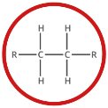Alkane | **~~-ane~~** | Methane |  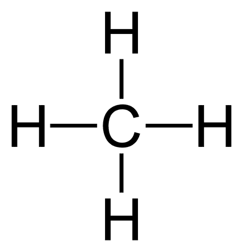 |
|  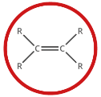Alkene | -ene | Ethene |  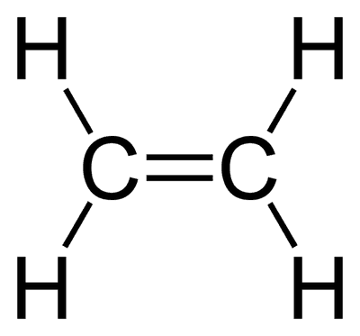 |
|  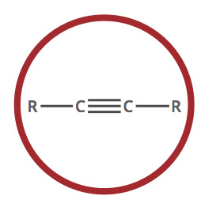Alkyne | -yne | Ethyne |  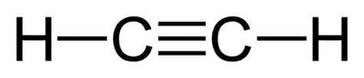 |
|  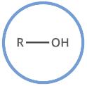Alcohol | -ol | methanol |  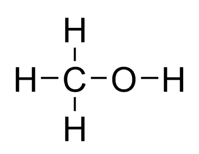 |
|  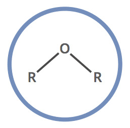Ether | -oxy- | methoxy-methane |  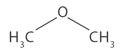 |
|  Haloalkane | halo-     -ane | Chloro-ethane |  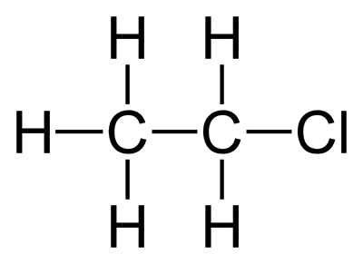 |
|  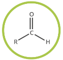Aldehyde | -al | Methanal |  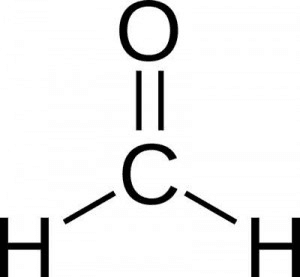 |
|  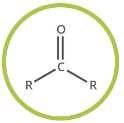Ketones | -one | Propanone |  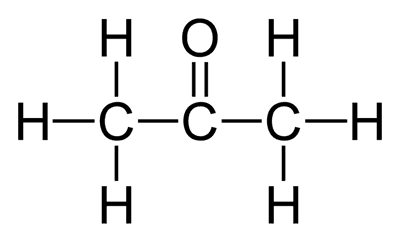 |
|  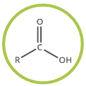Carboxylic Acid | -oic Acid | Methanoic Acid |  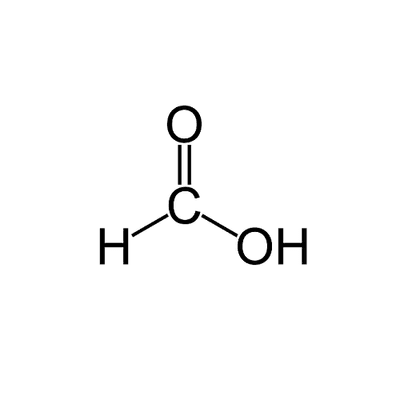 |
|  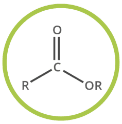Ester | -ate | Methyl-ethanoate |  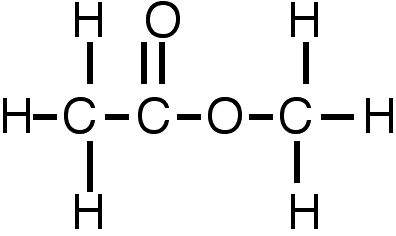 |
|  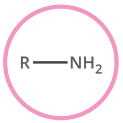Amine | -amine | Methyl-amine |  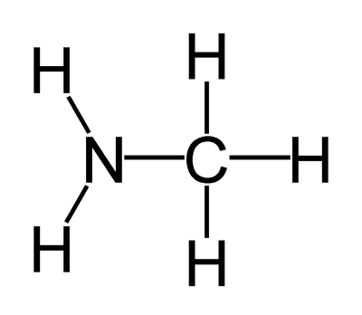 |
|  Nitrile | nitrile | Ethyl nitrile |  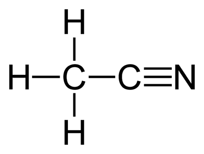 |
|  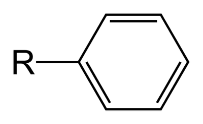Arene/Phenyl/Benzene | -benzene also have other naming methods | Nitro-benzene |  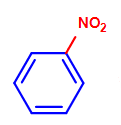 |
|  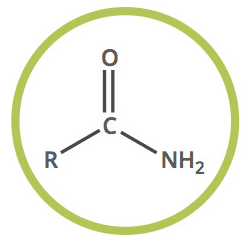Amide | amine | methyl-methanamine |  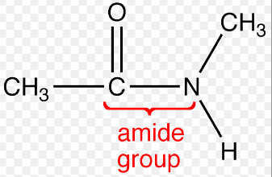 |

