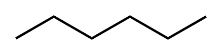

## Types of Formulae

  - Displayed formula (Hexane)

 

  - Structural formula (Hexane)
    
      - CH3-CH2CH2CH2CH2-CH3
        or CH3(CH2)4CH3

  - Skeletal formula (Hexane)

  - Molecular formula (Hexane)
    
      - C6H14