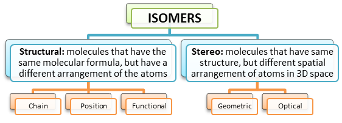

## Isomerism

  - Existence of two or more compounds with the same molecular formula
    but different structural formula

*Note:*

  - **Straight** chain alkanes have **higher b.p.** than branched

  - Branching makes molecule more spherical reduces contact points VDW
    forces decreases
