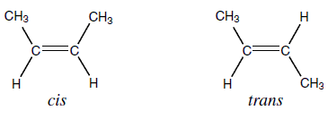

## Geometric (cis/trans) Isomers

  - Shown only by alkenes

  - Arises due to restriction of double bond

  - Only possible when each carbon has 2 different groups

  - cis-trans isomers have different b.p.

  - **cis** isomers have **higher dipole**

  - **trans** isomer of **symmetrical** alkene has **zero dipole**

