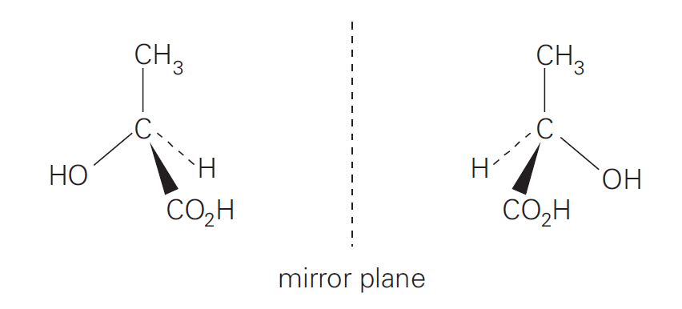

## Optical Isomers

  - Arises from different arrangement of atoms or groups in 3D space
    resulting in two isomers

  - Have effect on polarised light

  - **Chiral carbon:** a carbon having 4 single bonds and 4 different
    atoms or groups

  - Isomers non-super-imposable images of each other

  - Have **same physical and chemical** properties

  - No. of optical isomers in a molecule containing $n$ chiral carbons
    $= 2^{n}$

