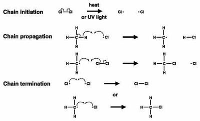

## Free Radical Substitution reaction

* Reactants are Halogens and Alkane.
* Involves 3 steps: initiation, propagation, and termination.
* requires the action of UV light or Heat.

## Initiation

* Breakdown of Chlorine into radicals.
* Uses the action of UV light.
* Starts the reaction.
* Creates radicals.
* $Cl_{2(g)} → 2Cl^o_{(g)}$

## Propagation

* Chlorine radical reacts with the alkyl/alkane.
* Helps the reaction to propagate (chain reaction).
* Maintains balance of radicals.
* $CH_4 + Cl^o → CH_3^o + HCl$
* $CH_3^o + Cl_2 → CH_3Cl + Cl^o$

## Termination

* Chlorine radical and alkyl radical reacts.
* Stops propagation of reaction.
* Reduces the number of radicals.
* $CH_3^o + Cl^o → CH_3Cl$
* $2Cl^o →Cl_2$
* $CH_3^o + CH_3^o → CH_3CH_3$

### Hint:

$CH_3^o$ and $Cl^o$ represents radicals which is neutral atom and an unpaired electron.