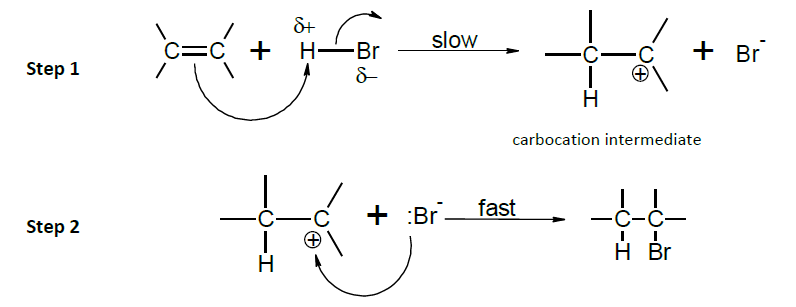

## Electrophilic Addition Mechanism

  - Electrophile forms by heterolytic fission

  - Electrophile attacks double bond

  - Pair of e-s from double bond migrate to electrophile and
    $\pi$ bond breaks

  - Carbocation formed which attacks the nucleophile
