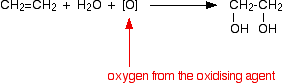
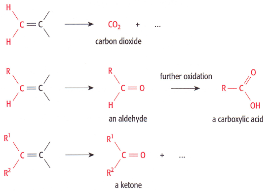

## Oxidation of Alkenes

* Both oxidation and addition to double bond involved
* KMnO4 changes from purple/pink to colourless

**With Cold Dilute Acidified KMnO4/H+**

* Diol is formed

 

**With Hot Concentrated Acidified KMnO4/H+**

* This leads to the rupture of the double bond
* Two compounds are formed
* Products formed depend on alkene

 