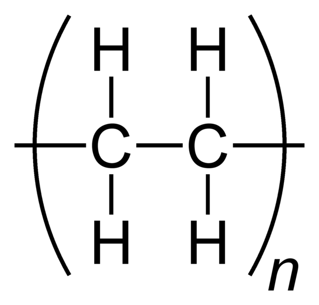
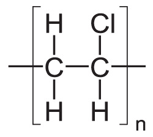

## Polymerisation

* **Addition Polymerisation:** Joining thousands of alkene monomers under high pressure, temperature, and catalyst conditions to form macromolecules (e.g., Polyethene, PVC).
* **Polyethene:**
  * LDPE: cling wrap
  * HDPE: water pipes, wire insulation

* **Polychloroethene (PVC):**
  * Water pipes
  * Insulation of wires

* **General conditions:** high pressure,

  high temperature and catalyst

**Environmental Disadvantages & Disposal:**

* Non-biodegradable plastics take up massive landfill space.

* Combustion releases toxic gases ($\text{SO}_2$, $\text{CO}_2$, and $\text{HCl}$ from PVC).

* **Solutions:** Recycling existing plastics or blending polymers with starch to enhance biodegradability.