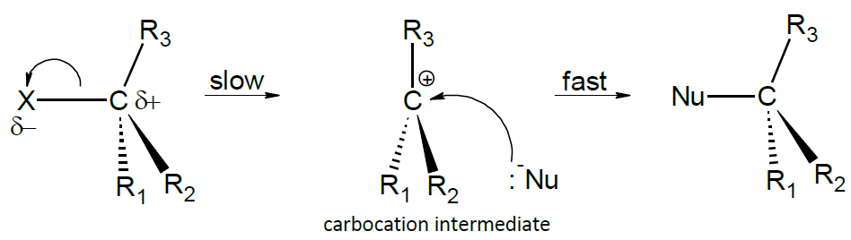
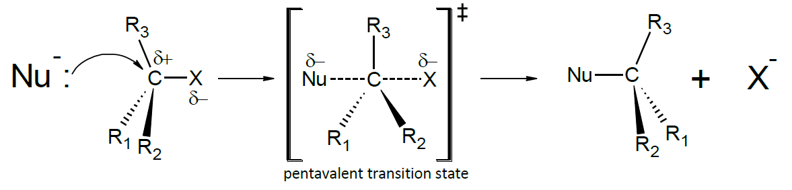

## Nucleophilic Substitution Mechanism

* The C-X bond is a polar bond and has partial charges due to the high electronegativity of halogen.
* The $\delta +$ carbocation is easily susceptible to attack by a
  nucleophile

**SN1 Mechanism:**

* Unimolecular – only one molecule involved in 1st step
* Secondary and Tertiary halogenoalkanes

**SN2 Mechanism:**

* Bimolecular – two molecules involved in 1st step
* Primary and secondary halogenoalkanes

