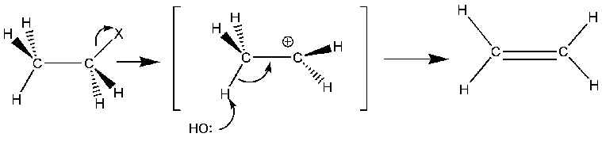

## Elimination Reaction

**R – X + OH- Alkene + X- + H2O**

**Mechanism:**

 

* Reagent: ethanolic NaOH or KOH
* Conditions: temp. 60oC, reflux
* OH- acts as a proton acceptor; it accepts the
  H+ loss from the halogenoalkanes during elimination
* Elimination becomes progressively easier

Primary < Secondary < Tertiary

* Note: the carbon atom adjacent to carbon with halide must have at least one hydrogen attached to it.

