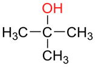

# Hydroxy Compounds

## Types of Alcohols

  - **Primary 1o**
    
      - 

  - **Secondary 2o**
    
      - 

  - **Tertiary 3o**
    
      - 

  - **Source of Alcohols:**
    
      - Hydration of alkenes
    
      - Fermentation
